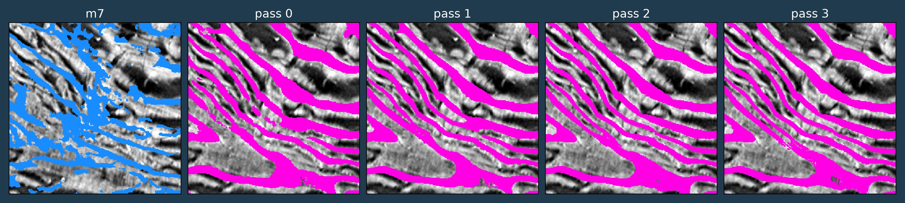
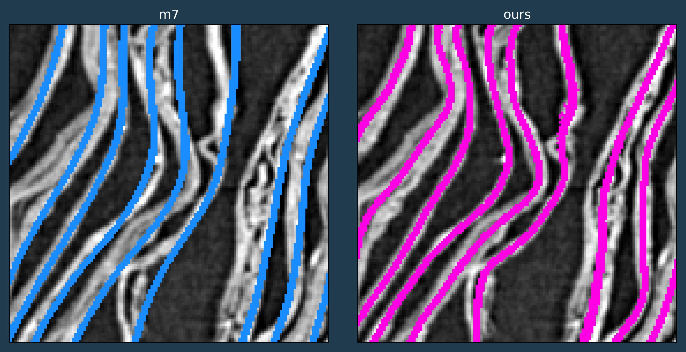
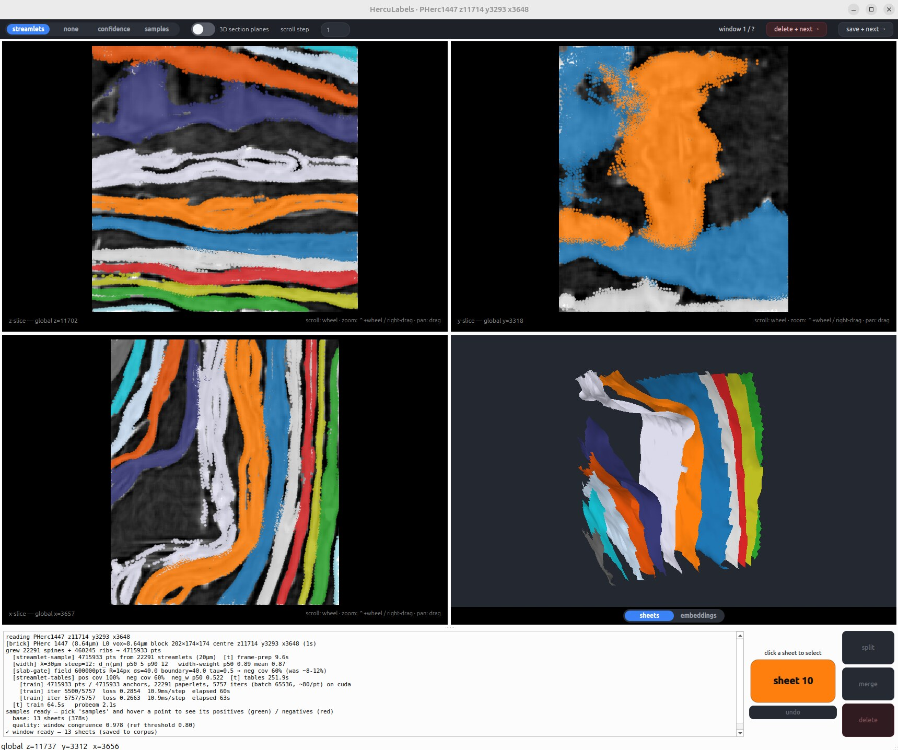
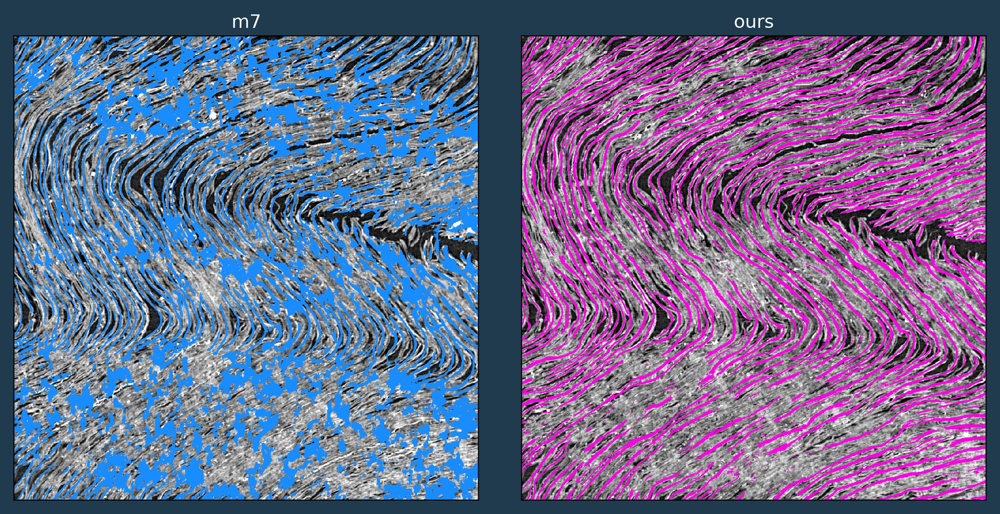
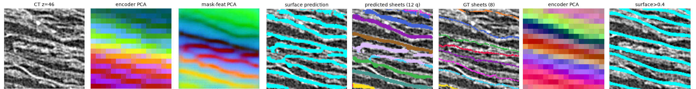
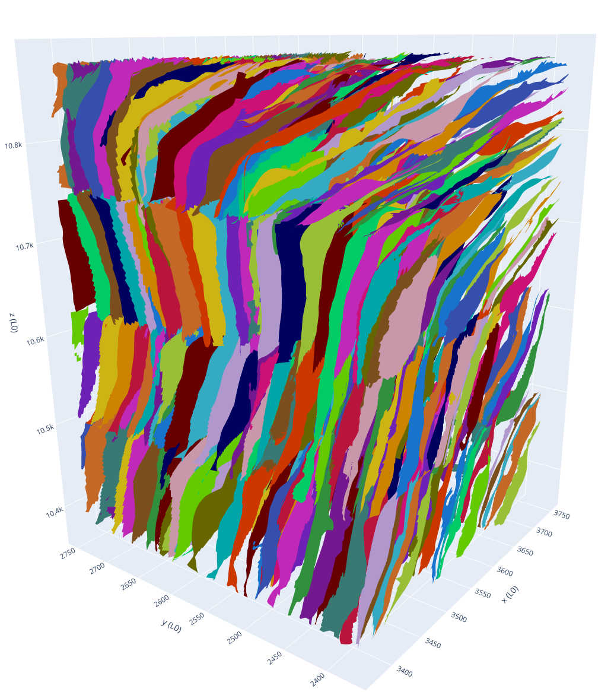

# HercUNet

> ## ⚠️ Repository reorganised (2026-10) — package layout + CLI changed
> The three products are now separate packages — **HercuLabels** (`hercunet/herculabels/`), **HercUNet**
> (`hercunet/hercunet/`), **HercuViT** (`hercunet/hercuvit/`) — over shared top-level modules. **Breaking:** the
> label-generation CLI is now **`herculabels`** (was `hercunet labels …`), the core install is now lean
> (install the per-product extra you need), and Python import paths changed. **Reinstall once** after pulling.
> → **[installation & usage](docs/README.md)** · **[migration guide](docs/hercuvit-migration.md)**.

**Three contributions to cross-scroll sheet (surface) detection in carbonised Herculaneum papyrus µCT —
HercuLabels, HercUNet, and HercuViT — over one shared streaming data layer.**

Each is a standalone piece of work with its own module, CLI, and write-up; they share only the fast streaming
reader for teravoxel OME-Zarr scroll volumes. HercuLabels and HercUNet are the v0 submission; HercuViT is a newer
third contribution (write-up in progress).


🧠 **[HercuLabels](#-herculabels--unsupervised-pseudo-labels)** — unsupervised pseudo-labels (the training corpus)  
🧠 **[HercUNet](#-hercunet--the-iterative-refiner)** — the iterative sheet refiner  
🧠 **[HercuViT](#-hercuvit--sheet-segmentation-on-a-frozen-µct-encoder)** — sheet segmentation on a frozen µCT encoder



## Why

Ink and text cannot be read until the papyrus sheets inside a scroll are correctly detected and separated — even
once ink is detected on the wrapped volume, you still have to unroll to read. Existing surface detectors are trained
per-corpus and don't generalise across volumes: they **merge touching sheets** and **break thin ones**, topological
errors that voxel-accuracy alone never fixes. The three contributions here attack that problem from different angles
— deriving multi-scroll labels without annotation (HercuLabels), an iterative refiner that corrects its own
topological mistakes (HercUNet), and reading the sheet primitive straight out of a frozen self-supervised encoder
(HercuViT) — all over a fast **streaming data layer** for teravoxel OME-Zarr.

> **⚠️ Faces vs medials — read before comparing.** HercUNet predicts the **medial** crest of each sheet (a thin
> surface at the sheet's centre, a few voxels inboard of the **faces** that all other labels — manual or m7-mined —
> annotate). This is a deliberate, different target, not an error, and it is why we report no Dice against face
> labels. Our stance: **it is better to have a sheet detection whose face lives flat at a few voxels' offset than
> one that is flat at zero offset only in some regions and waves harshly everywhere** — a consistent, correctable
> offset beats intermittent exactness.



---

## 🧩 HercuLabels — unsupervised pseudo-labels

🗂️ **Corpus:** [`jimmylomro/hercunet-corpus`](https://huggingface.co/datasets/jimmylomro/hercunet-corpus) on 🤗 — the ~4000 HercuLabels pseudo-label bundles (+ m7 rehearsal manifest) that HercUNet/HercuViT train on.

Fully unsupervised sheet instance-segmentation in small windows, purpose-built for pseudo-label generation (no
annotation, multi-scroll, native resolution). It allows sheet-width, normal and sheet-membership supervision, and
topological augmentations (merges/splits) that HercUNet trains against.

1. **CT window** — a small block of a scroll.
2. **Anisotropic diffusion** — coherence-enhancing diffusion cleans the substrate (sheets sharpen, gaps widen).
3. **Gradient field** — the density's structure tensor gives a per-voxel sheet-normal frame.
4. **Meshlets** — small oriented 2.5-D surface patches, grown along the field by tractography.
5. **Positive / negative selection** — a curvature-following slab picks same-sheet (green) and across-gap (red) pairs.
6. **Contrastive training** — those pairs train a low-D embedding: same-sheet meshlets collapse, adjacent wraps push apart.
7. **Clustering** — density clustering in the embedding recovers per-sheet instances.
8. **Sheets** — rasterised back to per-voxel sheet labels + honest confidence.
9. **Fine-tune m7 to validate** — check that the HercuLabels carry signal — they do.

CLI: **`herculabels`** (`create` / `edit` / `merge` / `export` / `m7-mine`). It is slow (~5 min per 192-vx cube) —
best run headless and left overnight; ~4000 were generated in the cloud and nnU-Net fine-tuned on them uncleaned.

→ Guide: **[docs/herculabels.md](docs/herculabels.md)** · Methodology: **[submission/writeup/herculabels.md](submission/writeup/herculabels.md)**



---

## 🔁 HercUNet — the iterative refiner

🧠 **Model:** [`jimmylomro/hercunet-v0`](https://huggingface.co/jimmylomro/hercunet-v0) on 🤗 (warm-start / re-train: `hercunet train fit --pretrained-hf jimmylomro/hercunet-v0`) · 🗂️ **Corpus:** [`jimmylomro/hercunet-corpus`](https://huggingface.co/datasets/jimmylomro/hercunet-corpus).

A self-refining, growing sheet-detection U-Net: a stock, pinned `nnunetv2==2.8.1` wrapped so it conditions on its
**own** previous output and corrects its own topological mistakes across passes.

1. **m7 backbone** — start from the `m7` nnU-Net ResEnc plan and its trained weights.
2. **New inputs** — add the model's own previous output (`prev`) and a carried orientation field from the CT's structure tensor (8-channel input: CT + `prev` + 6 orientation).
3. **Affinity head** — add an affinity output that drives instance separation.
4. **Loss stack** — symmetric Focal–Tversky (detection), a separation penalty, skeleton-recall (clDice), constrained MALIS on the affinity field, and a CT-material growth term.
5. **`prev` from labels** — a fixed fraction of the time, feed the HercuLabels (with their merge/split augmentations) as `prev`.
6. **Bootstrap** — zero the `prev` channel a fraction of the time, so the model also learns cold detection from the raw CT.
7. **DAgger** — condition on the model's *own* output as `prev`, not only on labels, so it learns to correct its own mistakes.
8. **Train** — ~500 epochs, warm-started from m7 weights.
9. **Iterate at inference** — 3–4 passes, each taking the previous pass's output as `prev` (with the seam-free overlap blend).

**Try it in one command** — no local data or setup; it pulls the model from Hugging Face, streams a window of
PHerc1447 from the open-data bucket, and writes an OME-Zarr you can open in VC3D (needs an NVIDIA GPU):

```bash
pipenv install ".[infer]"                               # or in a venv: pip install ".[infer]"
pipenv run hercunet infer single-instance PHerc1447 \   # SOURCE: scroll id, or an s3://|https://|file:// .zarr
  --model-hf jimmylomro/hercunet-v0 \
  --region 10889:11401,2848:3360,3915:4427 \
  --out ./infer-demo --passes 3                         # -> ./infer-demo_pass2.zarr (the deliverable)
```

→ Guide: **[docs/training.md](docs/training.md)** (train) · **[docs/infer.md](docs/infer.md)** (inference) · Methodology: **[submission/writeup/hercunet.md](submission/writeup/hercunet.md)**



---

## 🧠 HercuViT — sheet segmentation on a frozen µCT encoder

🧠 **Model:** [`jimmylomro/hercuvit-v0`](https://huggingface.co/jimmylomro/hercuvit-v0) on 🤗 (`hercuvit infer … --model-hf jimmylomro/hercuvit-v0`).

Sheet **instance**-segmentation read straight out of a **frozen** self-supervised Dinovol µCT encoder: a lightweight
CNN pixel-decoder learns a voxel-resolution upsample of the frozen tokens, a **decoupled** surface head answers
*is there a sheet*, and a Mask2Former-style instance decoder answers *which sheet* — the sheet primitive is already
present in the pretrained features, and a small decoder sharpens it to the voxel medial.

→ Guide: **[docs/hercuvit.md](docs/hercuvit.md)** (usage / CLI) · Methodology: **[submission/writeup/hercuvit.md](submission/writeup/hercuvit.md)** *(write-up in progress)*



HercuViT's output as geometry: the per-sheet instance masks fit to sheet meshes, read back from the compact `.asv` store.
> **This below is the same window as the HercuLabel above. HercuViT detections are slightly different,
> that's because it was trained for smaller 128vx^3 window sizes (this window is 192vx^3),
> plus the HercuLabel took 4 minutes to compute and HercuViT did it in about 2 seconds.**


**You can get the above result with as little as**:

```bash
pipenv install ".[hercuvit]"                              # or in a venv: pip install ".[hercuvit]"
pipenv run hercuvit infer single-instance PHerc1447 \     # SOURCE: scroll id, or an s3://|https://|file:// .zarr
  --model-hf jimmylomro/hercuvit-v0 \
  --region 11618:11810,3197:3389,3552:3744 \
  --mesh local --surf off --overlap 0 \
  --out ./hercuvit-demo                                   # -> ./hercuvit-demo_meshes.asv (the sheet store)
```

Fitted per-window sheet meshes, read straight from the compact `.asv` sheet store and coloured per sheet. Each window segments and labels its sheets independently, so the per-sheet colours do not carry across window boundaries — yet the sheet *surfaces* line up across them for the most part: the per-window geometry already agrees, and only the identities need reconciling (cross-window stitching, future work).



---

## ⚙️ Shared foundation — the streaming data layer

All three contributions read through one streaming layer for teravoxel OME-Zarr: chunk-aligned parallel fetch, an
on-disk L2 slab cache, transparent prefetch, and material tiling — so a concrete backend (streaming `vesuvius` or
procedural `demo`) is interchangeable.

→ Guide: **[docs/data-layer.md](docs/data-layer.md)**

## 📚 Documentation

**Install, GPU/CUDA setup, and CLI usage → [`docs/README.md`](docs/README.md).** Start there; each contribution and
the data layer has its own guide under [`docs/`](docs/):

- **[Install & CLI](docs/README.md)** — requirements, install extras, CUDA build selection, the three CLIs.
- **[Data layer](docs/data-layer.md)** — streaming OME-Zarr reads, caching, prefetch, tiling.
- **[HercuLabels](docs/herculabels.md)** — the `herculabels` CLI, the grinding viewer, the `.herculabels` corpus format.
- **[HercUNet — training](docs/training.md)** · **[HercUNet — inference](docs/infer.md)** — the refiner chain + the iterative full-volume driver.
- **[HercuViT](docs/hercuvit.md)** — the frozen-encoder sheet segmenter.
- **Reorg note:** **[docs/hercuvit-migration.md](docs/hercuvit-migration.md)** — old→new module paths, CLI rename, install extras.

## Status

The **data layer**, **HercuLabels** (with its interactive viewer), and **HercUNet** (train + iterative inference)
are complete and documented above. **HercuViT** is implemented and training; its write-up is in progress.
