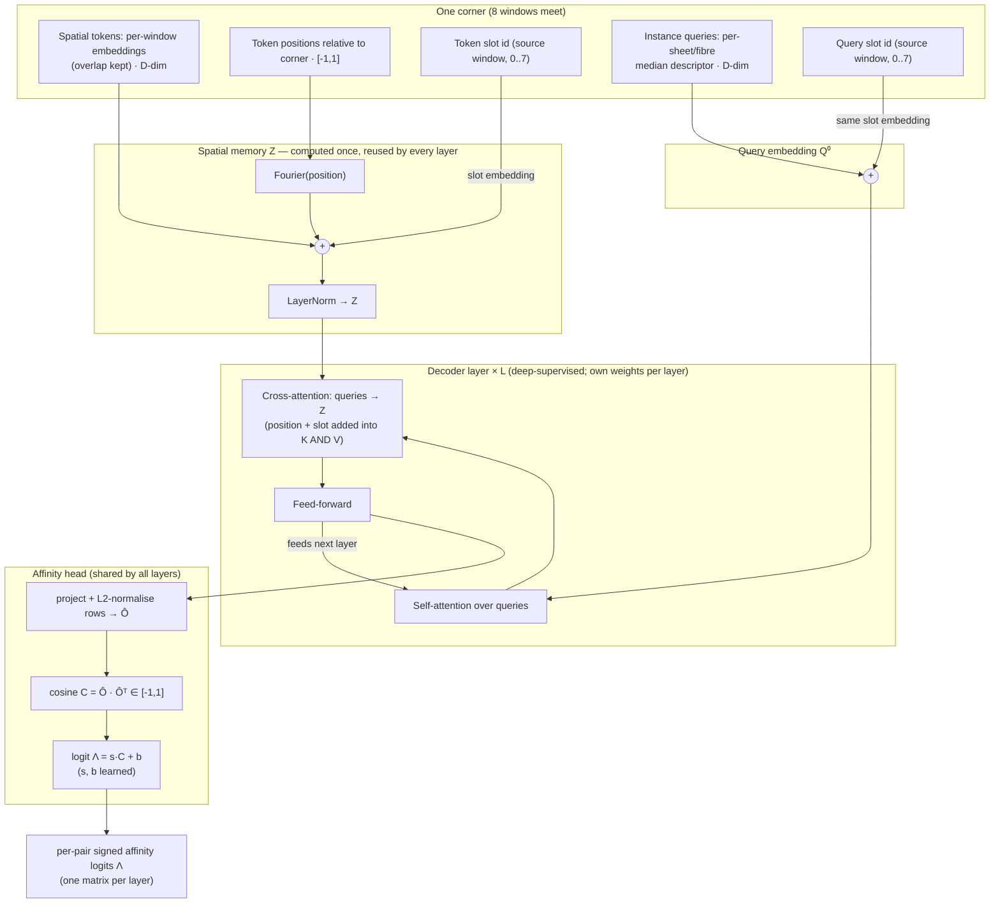

# Learned Cross-Window Instance Stitching

## Abstract

Instance segmentation of a teravoxel volume is run **window by window**: the volume is tiled, and each window is
segmented independently. Any instance larger than a window — a papyrus **sheet/fibre** that runs on for
centimetres — is therefore returned as several disconnected fragments, each with a window-local id unrelated to the
same instance's id in the neighbouring window. To assemble whole instances we must decide, for every pair of
fragments near a window boundary, whether they are the *same* physical object.

This document describes a small learned model that makes that decision directly from learned embeddings, with **no
hand-crafted geometric matching** (no mask overlap, no IoU, no surface-distance heuristics) and **no manual
annotation**. It is deliberately written **primitive-agnostic**: although our deployment stitches HercuViT
**sheet** instances, nothing in the method is specific to sheets, to fibres, or to HercuViT. The only
requirements are stated in §2, and any instance segmentor plus any encoder that satisfies them can be stitched the
same way.

---

## 1. The problem

Partition a large volume into a regular grid of overlapping windows. Segment each window independently; this gives,
per window, a set of instance masks with local ids. The same physical **sheet/fibre** appears in every window it
passes through, under a *different* local id each time, and — crucially — its embedding is expressed in a
representation the segmentor fit **independently per window**, so the embeddings are not directly comparable across
windows. (If they were, matching would be a nearest-neighbour lookup and there would be nothing to learn; the fact
that they are not is the whole reason this model exists.)

The task is to recover, across the whole volume, which per-window fragments are the same instance. We cast it as a
**graph problem**: fragments are nodes, the model predicts a signed affinity on each candidate pair of fragments
(an *edge*), and a graph-agglomeration step turns the signed edge graph into final object ids (§9).

---

## 2. What you need (the primitive-agnostic recipe)

The method applies to **any** instance primitive — a sheet/fibre, a cell, a neurite, anything segmented
window-by-window — provided you can supply two things in **the same coordinate space**:

1. **Instances per window.** Detect your sheets/fibres with *whatever* model you like. All the stitcher needs from
   it is, per window, a set of instance masks (which voxels belong to which local instance).

2. **A per-voxel embedding field over that same space.** Run an encoder (we use HercuViT/Dinovol) over the same
   windows and pool its per-voxel features to a coarse grid. The stitcher then **samples those embeddings over your
   instances**: a per-instance descriptor (the embedding averaged over the instance's voxels, §3) and a pooled
   spatial field of embeddings around each window corner (§4).

We use HercuViT for both because a **single HercuViT forward emits both out of the box** — the same pass produces the
sheet instance masks *and* the per-voxel embedding field — so the two are automatically registered in one
space, already encode instance identity, and need no second model. That is a convenience of HercuViT, **not** a
requirement of the method: the idea is general. The stitcher works identically with instances from segmentor *A* and
embeddings from encoder *B* — if you have instances and an embedding field, you can stitch them this way — **so long
as you sample the embeddings over your instances in the same space**. What the stitcher learns is not "what
a sheet/fibre looks like" but "given these local embeddings and their geometry around a seam, which fragments are the
same object" — a relation that transfers across primitives.

---

## 3. The embedding: a per-window reduction and a per-instance descriptor

Raw encoder features are high-dimensional and, more importantly, are **not aligned across windows**. We therefore
reduce them **independently per window** and let the model learn the cross-window relation, rather than assuming a
shared basis.

**Per-window normalised PCA.** For each window, z-score every raw feature dimension (statistics fit on the window's
*surface/foreground* cells — the structure the primitive lives on), then project every cell onto that window's
leading `D` principal directions (`D` is small; `D = 3` suffices, because instance identity already lives in a very
low-dimensional subspace of the features). Every voxel is now a `D`-dim vector in its *own window's* basis. This is
both a large storage reduction and the representation everything below uses.

**The per-instance descriptor is the median *after* the projection.** For one sheet/fibre fragment, take the
**per-dimension median of its already-projected cells**. Order matters: the median does **not** commute with the PCA
projection, so projecting the median of the raw features would land the descriptor off the manifold its own spatial
tokens live on, and the instance would no longer match its own region. We take the median (not the mean) for
robustness to fringe/boundary voxels; taken after projection it still sits exactly on the token manifold. This
median descriptor is the instance's **query** (§4); it is cheap, order-independent, and identical at every window
corner the instance reaches.

Because the reduction is per window, a window's spatial tokens and the descriptors of instances *from that window*
share one space — so a descriptor matches its own region's tokens — while relating it to a *different* window's
tokens (the stitch itself) is what the network learns, keyed by position and a source-window tag (§4).

---

## 4. One stitching sample: the corner where eight windows meet

Tile the volume so that window **cores** (the window minus its overlap margin) tile without gaps. A **corner** is a
point where eight such cores meet — a 2×2×2 block of windows. Each corner yields one stitching sample.

**Spatial memory (the "where").** Gather, from each of the eight windows reaching the corner, its pooled per-window
embeddings inside a cube centred on the corner — **overlap kept**, so a voxel in the shared margin contributes one
token per window that sees it (independent views of the seam are corroboration, not conflict). Each token carries:
its `D`-dim embedding; its **position** relative to the corner (normalised to `[-1, 1]`); and a **slot id**.

**Queries (the instances).** For each of the eight windows, every sheet/fibre whose extent reaches the corner cube
becomes a query: its median descriptor (§3) and its slot id.

**Slot id = provenance, not position.** The slot `4·b_z + 2·b_y + b_x` names *which of the eight windows* a token or
query came from (`b_a` = which side of the corner that window's core sits on). It is deliberately decoupled from
position (supplied separately), because a token kept from a window's overlap can physically lie on the *other* side
of the corner while still belonging to *its* window. Both tokens and queries look up the **same** small learned slot
table — the one window-level fact that transfers. The global window index is never shown to the network; it carries
no transferable meaning.

At the volume border fewer than eight windows exist; the missing slots are simply marked invalid, and training
includes such corners so the model handles them.

---

## 5. The network

A **decoder-only transformer**. The spatial memory is embedded **once** (there is no spatial encoder); the instance
queries then, for `L` layers: self-attend to each other, cross-attend to the spatial memory, and pass through a
feed-forward block. A shared cosine head turns each layer's refined queries into a pairwise affinity matrix, and
**every** layer is supervised (deep supervision).

One detail is load-bearing: position and slot are added into the **keys *and* values** of the cross-attention, not
the keys alone. In a standard decoder, position enters only the keys, so a query learns *what* it attended to but not
*where*. Here "where a fragment sits relative to the seam" is exactly the evidence the stitch needs, so it must flow
through the values into the queries.



**The affinity head and why logits are signed.** Each query is projected and L2-normalised to a unit vector `Ô`; the
pairwise affinity is the cosine `C = Ô·Ôᵀ`, rescaled to a logit `Λ = s·C + b` by two learned scalars. The scale `s`
stretches the narrow cosine range so the model can be confident; the bias `b` places the decision boundary (with
rare positives it belongs well above cosine 0). The **sign** of `Λ` is the whole point: `Λ > 0` attracts (same
instance), `Λ < 0` repels (different instances), `Λ = 0` is the decision boundary (probability ½). Signed costs are
exactly what the graph solvers in §9 consume — a strong negative edge can *actively block* a wrong merge, not merely
fail to support it.

---

## 6. Generating labels without annotation

A training label is nothing more than a **same-object assignment of the per-window fragments at a corner** — for each
pair of fragments: "same instance", "different instance", or "unknown". The stitcher does not care *how* that
assignment was produced: **any pseudo-stitching method works**, automated or manual. You could overlap-vote the
fragments against a centred pass (what we do, below); run a classical geometric matcher (mask IoU, surface distance,
normal continuity) across the seam; agglomerate some existing affinity graph; or simply **hand-label** which fragments
are the same at a sample of corners. Each produces the same `1 / 0 / ignore` matrix the loss consumes. The method
below is the one we use because it is fully self-supervised and needs no annotation — it is an *instance* of the
general recipe, not a requirement of it.

**Our method — extract your instances, their descriptors and the window embeddings, then add one centred window.** At each
corner, run your segmentor on the **eight octant windows** (the 2×2×2 block, overlapped as in §4) and build their
spatial tokens and per-instance median descriptors exactly as at deployment. Then run it **once more on a window
centred on the corner**. In that single centred pass, an instance crossing the corner has **one** consistent id
across the whole neighbourhood — so the centred pass is a local "ground truth of ids" that the eight independent
windows can be voted against.

**Overlap voting → a same-object label matrix.** For each octant fragment, sample the region it shares with the
centred window and, where *both* passes confidently see a surface there, read off which centred-pass instance it
overlaps most; that centred-pass id becomes the fragment's **global id** at this corner. Two fragments then get a pair
label — **same**, **different**, or **ignore**:

- **same** if they share a global id;
- **different** if their global ids differ — and, **by default**, also in the two cases where a difference is
  *certain* without needing a shared vote: (a) two fragments from the **same window** (a window assigns each voxel a
  single owner, so distinct owners there are distinct instances), and (b) a fragment with **no reliable cross-window
  correspondence at this corner** (it is off-seam *here* — it earns its positive labels at the neighbouring corner
  where it *does* meet a seam, and is a negative against the seam-meeting fragments here);
- **ignore** only for the residual, genuinely-ambiguous pairs.

**Marking these certain negatives as negatives — rather than ignoring them — is the default, and it matters.** The
bare overlap vote labels a fragment only where it meets the centred pass, so most of the pair matrix would otherwise be
*ignore* and the loss would train on a small sliver of it. Promoting the certain negatives (same-window pairs, and
off-seam fragments at this corner) turns a sparsely-labelled matrix into an effectively fully-labelled one — a large
gain in usable signal, and in particular it supplies exactly the near-neighbour / adjacent-wrap **hard negatives** the
stitcher must get right. The small label noise this adds (an off-seam fragment that is, in truth, the same instance as
something at this corner) is precisely the kind of *unbiased* error the model averages away given enough corners (see
below).

This is label construction at *training* time only; the network never sees the centred pass or any overlap
information — at deployment it sees only the eight real windows (§4). If an annotated sub-volume *is* available, its
segmentation can replace the centred pass (or whatever pseudo-stitcher you use) to give exact labels against the
annotation instead of against the model; the rest is unchanged.

**Label volume matters, and systematic bias is the one real danger.** Whatever pseudo-stitcher you choose will make
mistakes, and those become noisy labels — but two different things decide whether they hurt. First, **volume**: with
enough corners, *random* pseudo-stitching errors are inconsistent across the dataset and the network averages them
out, learning the relation the labels agree on rather than the noise they disagree on — so more labelled corners
directly buy robustness to label noise. Second, and more consequential, **bias**: an error the pseudo-stitcher makes
*consistently* — always merging the same kind of adjacent-wrap pair, always splitting at the same geometry — is not
noise that averages away; it is a signal, and the network will faithfully learn it and carry it into its predictions.
So the care in generating pseudo-labels belongs on avoiding *systematic* error, not on chasing every individual
mistake: a pseudo-stitcher that is wrong often but **unbiasedly** still trains a good model, whereas one that is wrong
rarely but **always in the same direction** teaches exactly that bias. That said, this is a soft caution rather than a
hard constraint — the model is remarkably good at overcoming unbiased label error, which is precisely what our
fully-self-supervised overlap-voting labels and the published model demonstrate: noisy, no-ground-truth labels, and a
stitcher that nonetheless assembles sheets well.

**The loss** (summed over all `L` layers, deep supervision) has two complementary terms on the labelled pairs,
ignoring the rest:

- a **focal, class-balanced binary cross-entropy** on the signed affinity logits — most pairs are negatives, so the
  positive class is up-weighted and the focal term concentrates the gradient on the hard near-misses (adjacent
  instances that look alike) rather than the trivial far-apart negatives; and
- a **supervised-contrastive** term on the unit query embeddings — each fragment is pulled toward its same-instance
  fragments and pushed from the different-instance ones, with fragments from the *same* window acting as free hard
  negatives (two fragments in one window are, by construction, different instances).

**Note — augmentation and seam-token dropout for longer-range relationships.** Two cheap, optional additions should
push the model to reason over longer distances than a single seam. General **sample/label augmentation** — perturbing
embeddings, dropping queries, simulating splits and merges, invalidating whole slots (as at border corners) —
regularises the decoder and exposes it to more of the relational variety it meets at deployment. More specifically,
**dropping the overlapping seam tokens** from the spatial memory (the co-located tokens where two windows see the same
voxel, §4) removes the easiest matching evidence and forces the model to relate fragments by the longer-range
geometric and embedding cues that carry across a whole window, rather than leaning on the overlap. Both are orthogonal
to the label source above and can be applied with any pseudo-stitcher.

---

## 7. Storing the embeddings and the affinities

The deployment path keeps the two artifacts the stitcher consumes, and writes the affinities **back into the same
instance store** so one file carries both the geometry and the graph.

**Per-instance embeddings live with the instances.** When the segmentor writes its per-window instance geometry, it
also writes, in each instance's own record, that instance's **median descriptor** (§3) in its window's per-window
basis. So every sheet/fibre already carries the query the stitcher needs. In parallel, the pooled per-window
embedding field (the spatial-memory source) is stored once per window, tagged by the window's global origin.

**Affinities live in a separate, indexed edge table.** The stitcher's output is a set of signed edges, which do
**not** belong inside the per-instance records — an instance has *many* neighbours, and we want to query them without
rewriting geometry. They are therefore written to their own table, one row per directed pair: `(src, dst, logit,
probability, corner)`, where `src`/`dst` are instance ids and `corner` records which window corner produced the
edge (a pair can recur at several corners; aggregating those duplicates is the separate step in §9). The table is
**indexed on `src`**.

**Both directions are stored.** The affinity head is symmetric (`Λ(A,B) = Λ(B,A)`), yet we store **both** `(A→B)`
and `(B→A)`. This is deliberate: it makes "every neighbour of instance `X`" a single indexed lookup on `src = X`,
with no need to also scan the `dst` column. Querying the graph is then trivial and fast: to colour, inspect, or
agglomerate around any sheet/fibre, look up its row set, and its in-range neighbours with their signed strengths come
back directly — which is exactly what the interactive tools and the agglomeration in §9 do.

---

## 8. From affinities to assembled instances

The edge table is a signed graph over all fragments. Assembling whole instances is a **graph agglomeration** on that
graph; because the edges are signed (§5), the solver can cut uncertain merges rather than chaining everything
together.

1. **Aggregate duplicates.** A pair seen at several corners (and in both directions) is collapsed to one edge with
   the **mean** logit — a simple, robust consensus across the corners that observed it.
2. **Solve.** On the signed, aggregated graph, run a signed-graph partitioner. A plain union-find above a logit
   threshold is the fast baseline but one wrong positive can chain two large objects together; **average-linkage
   agglomeration on the signed weights (GASP)** is the recommended default — it merges the strongest mutually
   attractive clusters while any positive accumulation remains and lets repulsive accumulations block merges, so
   error chains are stopped. Each connected component after the solve is one assembled instance.

The original masks are never rewritten: the result is a lookup from fragment id to assembled-object id, applied
lazily, so several solves (different thresholds, different solvers, manual edits) can coexist over one geometry
store.

### 8.1 Interactive auto-stitch (worked algorithm)

The same signed graph drives an **interactive** assembler: from one selected sheet/fibre, agglomerate its local
neighbourhood on demand and add its resulting cluster to the current selection. A window-neighbourhood radius `r`
bounds the work to the `(2r+1)³` block of windows around the seed (`r = 1` is the immediate 3×3×3 block, `r = 2` the
5×5×5, and so on). In pseudo-code:

```
auto_stitch(seed_instance, radius r):
    # 1. candidate instances: those whose source window lies within r window-steps
    #    of the seed's window on every axis (Chebyshev ball on the window lattice).
    (sz, sy, sx) <- window of seed_instance
    build sorted unique window coordinates per axis           # robust to gaps in the grid
    candidates <- { instance : |rank(win.z) - rank(sz)| <= r
                             and |rank(win.y) - rank(sy)| <= r
                             and |rank(win.x) - rank(sx)| <= r }
    candidates <- candidates ∪ { seed_instance }
    if |candidates| < 2: return

    # 2. edges among candidates, aggregating duplicates to the mean logit (§8, step 1).
    #    affinities(c) is the single indexed lookup of §7 (both directions stored).
    acc <- empty map keyed by unordered pair {a,b}
    for c in candidates:
        for (dst, logit) in affinities(c):
            if dst in candidates and dst != c:
                acc[{c, dst}].sum += logit ;  acc[{c, dst}].n += 1
    edges <- [ (a, b, acc[{a,b}].sum / acc[{a,b}].n) for each pair ]

    # 3. agglomerate the signed graph; keep the seed's cluster.
    labels <- gasp_average_linkage(nodes = candidates, edges = edges)
    cluster <- { c in candidates : labels[c] == labels[seed_instance] }
    add cluster to the current selection
```

where the agglomeration is average-linkage on the signed weights:

```
gasp_average_linkage(nodes, edges):
    union-find over nodes; cluster_adjacency[u][v] = (summed_weight, edge_count)
    push every inter-cluster pair with positive mean weight into a max-heap keyed by mean weight
    while heap not empty:
        (w, u, v) <- pop max
        ru, rv <- find(u), find(v)
        if ru == rv: continue
        if no live edge ru–rv, or its current mean <= 0, or it != w:  # stale / turned repulsive
            continue
        merge rv into ru:                                             # fold rv's adjacency into ru
            for each neighbour x of rv (x != ru):
                cluster_adjacency[ru][x] += cluster_adjacency[rv][x]  # sum weights and counts
            drop rv
        for each neighbour x of ru with positive mean weight:
            push (mean weight, ru, x)
    return connected-component label per node
```

The merge rule is parameter-free and order-robust: clusters merge in descending **mean** inter-cluster affinity, a
merge is skipped once its accumulated weight is no longer positive (a repulsive accumulation blocks it), and stale
heap entries — superseded by a later merge — are detected and discarded. Taking the seed's component yields exactly
the instances the graph says belong with the one the user picked.

---

## 9. Summary

The stitcher is a small, annotation-free, **primitive-agnostic** model that learns to reconnect window-fragmented
instances from learned embeddings alone. Give it instances from any segmentor and an embedding field over the same
space; it reduces the embeddings per window, describes each sheet/fibre by a median descriptor, and at every
eight-window corner predicts signed affinities between the fragments that meet there. Those affinities are stored as
an indexed edge table beside the geometry, and a signed-graph agglomeration — batch for the whole volume, or
interactive from a seed — turns them into assembled, scroll-spanning instances. Nothing in the pipeline is specific
to sheets, to fibres, or to the encoder we happen to use; the one requirement is that the embeddings are sampled over
your instances in a shared space.
