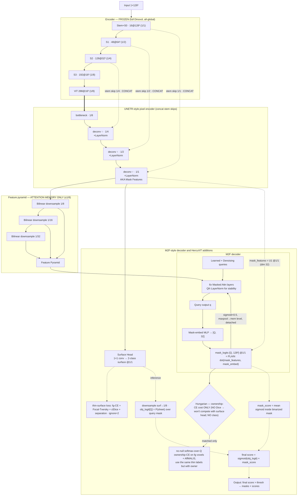

# HercuViT: Sheet Instance Segmentation on a Frozen Self-Supervised µCT Encoder

## Abstract

Virtual unwrapping of a carbonised Herculaneum scroll rests on one geometric primitive: separating the wound
papyrus into its individual sheets. We ask whether this primitive is already *present* in a self-supervised
representation of the raw micro-CT — before any surface label is seen — and we find that it largely is. Using a
DINOv2-style 3D encoder pretrained only on scroll µCT (no surface or ink annotation), we show, over 250
held-out windows, that (i) the presence of a sheet surface is **linearly decodable** from the frozen token
embeddings — a single fixed linear direction separates sheet from background at a held-out AUC of 0.76 and Dice
of 0.77, and a window-adapted prototype at Dice 0.85; (ii) that this sheet/background signal is **low-dimensional**
— a few dozen of the 288 directions carry essentially all of it; and (iii) that the embeddings carry **sheet
instance identity** even more strongly than surface presence: two patches on the same sheet are more similar
than two patches on different sheets (cosine 0.49 vs. 0.16), a separation a cosine threshold already reads out at
AUC 0.82 — and in an even *lower*-dimensional subspace (~12 directions) than surface presence (~32). The sheet
signal is carried by *direction*, not magnitude. All of these figures are measured at the
encoder's coarse 76.8 µm token scale and are inflated by it: they characterise what the frozen representation
makes *available*, which a decoder must still sharpen to the voxel-level medial — not full-resolution accuracy.
These
measurements are the empirical foundation for HercuViT, a sheet instance-segmentation network that **freezes the
encoder** and trains only a lightweight decoder with a *decoupled* surface/identity head. We report the
representation-geometry analysis (§1–§4), the resulting architecture (§5), and a direct measurement that the trained
decoder **sharpens sheet identity into a near-perfect, essentially 2-dimensional, voxel-resolution code** (identity
ranking AUC 0.94 on its 1/1 mask features, §6) — closing the loop from "the primitive is latent in the frozen
features" to "a small decoder reads it out at voxel scale".

---

## 1. Setting: is the sheet primitive already in the features?

The dominant paradigm for sheet surface detection in scroll µCT trains a full convolutional network end-to-end
from raw voxels against mined or hand-drawn surface labels. Such a network must learn, from the label signal
alone, both *what a sheet looks like* in the imaging physics and *how to localise it* — and it entangles the two
in weights that do not obviously transfer across scrolls. A different hypothesis has become available with the
arrival of self-supervised 3D encoders trained at scale on unlabelled scroll volumes: that the raw
representation already separates papyrus sheet from surrounding matrix, and even distinguishes adjacent wraps,
as a by-product of the pretext task — so that the supervised problem reduces to *reading out* a structure the
encoder has already built, rather than discovering it.

If that hypothesis holds, the architectural consequence is immediate and large: the encoder can be **frozen**,
the expensive representation is computed once, and the only trainable part is a small decoder that decodes
surface and identity from fixed features. This is the regime HercuViT occupies, and this section establishes the
evidence for it. We treat the question empirically and quantitatively: we never fine-tune the encoder, and we
measure what its untouched features already contain.

### 1.1 The encoder

We use a DINOv2-style [1] volumetric encoder ("Dinovol"), pretrained self-supervised on Herculaneum scroll
micro-CT with no surface, sheet, or ink supervision of any kind [2]. The model operates at an isotropic working
resolution of 9.6 µm with a patch size of 8 voxels, so each output token summarises a 76.8 µm cube of material,
and emits a 288-dimensional embedding per token. For a 128³-voxel input window the encoder produces a 16³ grid
of such tokens (a 1/8-resolution embedding field). Throughout this work the encoder's weights are held fixed
(`requires_grad = False`, evaluation mode); nothing in the analysis below, and nothing in the HercuViT decoder,
back-propagates into it.

All embedding statistics in this section are therefore measured at the encoder's **native 1/8 token
resolution**. This is a deliberate and honest scope: a sheet surface is a thin, roughly one-voxel medial
structure at full resolution, and a single 76.8 µm token straddles both the surface and the material on either
side of it. The frozen features cannot, and are not claimed to, localise the surface to a voxel; what we test is
whether they *contain* the sheet/background distinction and the sheet-identity distinction at the token scale.
Recovering the thin, voxel-exact surface from these features is the job of the trained decoder and is reported
separately.

---

## 2. Experimental setup

### 2.1 Data and token labelling

We draw N windows of 128³ voxels from the held-out split of the HercuViT label corpus — gate-passing windows of
mined pseudo-labels, each carrying a thin medial-surface map and a per-voxel Voronoi sheet-instance identity
(the labels described in the companion corpus report). Because the encoder was pretrained without any labels,
every labelled window is, with respect to the encoder, out-of-sample; the train/held-out distinction below
pertains only to the *linear probes* we fit on top of the frozen features, never to the encoder itself.

Each 16³ token is assigned a label by pooling the full-resolution annotation over its 8³ receptive field. A
token is **sheet-surface** if its field contains at least two medial-surface voxels and is not dominated by the
ignore region; it is **background** if its field contains no surface and no ignore voxels; tokens that are
predominantly ignore (collapsed-sheet or low-confidence regions) are discarded. For identity analysis, a
sheet-surface token is additionally assigned the modal Voronoi owner over its surface voxels. This pooling is
the only place full-resolution labels enter the analysis; all probes operate on the 288-d token embeddings.

### 2.2 What we measure

**(A) Linear decodability of sheet vs. background.** We test three probes of increasing stringency. *Per-window
prototype:* within each window we form a single sheet prototype — the mean unit embedding of its sheet tokens —
and score every token by cosine similarity to it; sweeping a threshold yields the best achievable Dice of
(cosine > τ) against the true sheet tokens, reported as a per-window mean. *Global prototype / held-out linear
probe:* we fit a single Fisher linear discriminant [3] on the sheet-vs-background embeddings of 70 % of the
windows and evaluate its area under the ROC curve (AUC) and best Dice on the **disjoint** remaining windows, so
that no window contributes to both the probe and its evaluation. A high held-out AUC means a *single fixed
linear direction* in the 288-d space separates sheet from background across windows.

**(B) Intrinsic dimensionality of the sheet signal.** We quantify how many of the 288 directions the
representation actually uses in two ways. First, over the on-sheet and the background token clouds separately,
we compute the covariance eigenspectrum and summarise it by the *participation ratio*
(PR = (Σλᵢ)² / Σλᵢ², an effective number of equally-weighted dimensions) [4] and the *effective rank*
(the exponential of the spectral entropy) [5]. Second — the operational question — we project the embeddings
onto their top-k principal directions, re-fit the held-out linear probe in that k-dimensional subspace, and
trace held-out fg/bg AUC as a function of k; the smallest k reaching 99 % of the full-dimensional separability
is reported as the dimensionality the sheet/background decision requires.

**(C) Sheet identity.** Restricting to single-owner sheet tokens, we sample pairs within the same window and
compute cosine similarity for same-sheet versus different-sheet pairs (same window, so illumination and local
context are controlled). The separation of the two distributions — summarised by the AUC of ranking same-sheet
pairs above different-sheet pairs — measures how directly instance identity is readable from the frozen
features by similarity alone.

**(D) Representation geometry.** We additionally report the embedding-norm distributions for sheet and
background tokens, as a basic check on whether the sheet signal is carried by magnitude or by direction.

All AUCs are computed by the Mann–Whitney statistic; linear discriminants are regularised by a small multiple of
the mean eigenvalue of the within-class scatter. [Sample sizes and the exact window count are reported with the
results.]

---

## 3. Results

The analysis below is computed over 250 held-out windows, yielding 120 000 sheet-surface tokens and 93 000
background tokens after balancing; all probe AUC/Dice figures are evaluated on windows disjoint from those used
to fit the probe.

> **All numbers in this section are measured at the encoder's 1/8 token grid (76.8 µm patches), and the
> coarseness of that grid inflates every one of them.** A token is counted as "sheet" when its 8³ receptive
> field merely *contains* surface — a forgiving, high-base-rate criterion, since a thin medial passing through a
> window lights up a whole plane of tokens. The sheet/background Dice and AUC, the participation ratios, and the
> identity AUC therefore describe surface *presence and identity at the 76.8 µm patch scale*, **not** voxel-level
> localisation of the ~1-voxel medial. They are an upper-bound characterisation of what the frozen features make
> *available*; they are not, and must not be read as, the Dice a readout achieves at full resolution. The
> voxel-exact thin-surface task — on which a trained model is scored, and where a single-voxel offset collapses
> the strict Dice — is strictly harder and is the decoder's job (§4). Where we quote a model's full-resolution
> surface quality elsewhere, we report it separately and with a ±1-voxel tolerance, as is standard for a
> one-voxel medial target.

### 3.1 Sheet surface is linearly decodable from frozen features

A single fixed linear direction in the 288-dimensional embedding space separates sheet-surface tokens from
background tokens at a **held-out AUC of 0.757 and a best Dice of 0.768** (Figure 1); the discriminant fit on
training windows transfers to held-out windows almost without loss (train AUC 0.797 → held-out 0.757), so the
direction is a genuine, window-independent property of the representation rather than a per-window artifact.
When the probe is allowed to adapt to each window — a single prototype formed from that window's own sheet
tokens, thresholded by cosine similarity — the separability rises to a **per-window mean Dice of 0.846 (median
0.860)**. The gap between the two is informative: the sheet/background boundary is linearly present but not
globally affine-stationary, consistent with the token scale, where a 76.8 µm patch centred on a surface and one
centred on the adjacent intact papyrus are genuinely similar material. That a *window-local* linear readout
already reaches Dice 0.85 is the operative point — it is exactly the regime a convolutional decoder with a local
receptive field can exploit.

### 3.2 The sheet/background decision is low-dimensional

The representation does not spread the sheet/background signal across all 288 dimensions. Projecting the
embeddings onto their top-k principal directions and re-fitting the held-out linear probe, AUC climbs from 0.61
at k = 1 to 0.72 by k = 16 and reaches **90 % of the full-dimensional ceiling by k = 32**, after which it is
essentially flat — the gain from the remaining ~230 directions is within noise (Figure 2). So **a few dozen directions
carry essentially all of the linearly accessible sheet/background information**. The embedding clouds themselves
are correspondingly compact: the on-sheet tokens occupy a participation ratio of 46 effective dimensions and the
background tokens 28 (effective ranks 79 and 65), out of 288 (Figure 3). Two things follow. The on-sheet cloud is
*richer* than the background cloud — background µCT is comparatively featureless, while sheets carry orientation,
curvature and wrap-specific texture — and both are far from filling the ambient space, which is why a compact
learned mask-feature head (we use 32 channels) loses little.

### 3.3 Sheet identity is present in the frozen representation — more strongly than surface

The frozen features distinguish *which* sheet a patch belongs to more sharply than they mark surface against
background. Among single-owner sheet tokens drawn from the same window, pairs on the **same** sheet have mean
cosine similarity 0.49, while pairs on **different** sheets average 0.16; ranking same-sheet pairs above
different-sheet pairs by cosine alone achieves an **AUC of 0.819** (Figure 4) — higher than the 0.757 for
surface presence. An encoder trained only to model the appearance of scroll material, with no notion of a
"sheet", has nonetheless learned a representation in which co-membership of a wrap is a dominant axis of
similarity. This is the single most consequential measurement for an *instance* segmentation method: the
identity the network must predict is already latent in the features, so the decoder's instance head is reading
out structure rather than inventing it. And the identity decision is **lower-dimensional than the surface
decision** — sweeping the same-vs-different cosine AUC against the number of retained principal directions, it
reaches 90 % of its ceiling by just **~12 directions**, against ~32 for sheet/background (Figure 2). "Which
sheet" lives in a tighter, cleaner subspace than "is there a sheet".

### 3.4 The sheet signal is directional, not magnitude

Sheet-surface tokens do not stand out by embedding norm — if anything the reverse: mean ‖·‖ is 11.5 for sheet
tokens against 12.9 for background. The sheet and identity information is therefore carried by the *direction* of
the embedding, not its length. This is not a cosmetic detail: it is the justification for a readout built on
inner products of unit-like features — cosine-prototype decoding here, and the dot-product mask head in the
network — rather than on magnitude thresholds.

---

## 4. Implications for the architecture

These measurements set the design of HercuViT directly, and each architectural choice below is a response to a
number above rather than a default.

**Freeze the encoder.** The features already contain the sheet primitive — surface at held-out AUC 0.76,
identity at 0.81 — without ever having seen a label. There is little for end-to-end fine-tuning to add to the
representation and much for it to overfit or distort; freezing the encoder makes the expensive 3D forward a
one-time cost and confines all learning to a small decoder. This also preserves the stem skip features the
decoder consumes: because the encoder is fixed, the multi-resolution skips are a stable function of the input
that the decoder cannot corrupt.

**A lightweight decoder suffices, and must supply localisation, not recognition.** The thing the frozen features
*lack* is voxel-exact localisation — by construction, a 76.8 µm token cannot place a one-voxel medial surface.
The decoder's job is therefore the comparatively modest one of up-sampling and sharpening an already-separated
representation, which is why a small residual decoder on the frozen skips is adequate and a large end-to-end
network is not required.

**Decouple surface from identity.** Surface presence and sheet identity are encoded with different strengths
(0.76 vs. 0.81) and are different questions — "is there a sheet here" versus "which sheet". HercuViT reads them
with separate heads: a surface/objectness head and an instance-identity head over the mask features. Collapsing
them into one objective forces a single representation to serve both and, as we find elsewhere, lets the
easier/again-dominant signal starve the other.

**Read out by direction, at a compact width.** Because the signal is directional (§3.4) and low-dimensional
(§3.2), the mask-feature head is a narrow (32-channel) projection read by inner product, not a wide
magnitude-based map. The identity decision the head must carry is only ~12-dimensional, and the on-sheet cloud
~46; a 32-channel head sits comfortably above the former and near the latter — enough to hold the identity axes
the probe found, without the waste of reading out all 288.

---

## 5. The HercuViT architecture

HercuViT reads the frozen representation with a lightweight decoder that answers the two questions — *is there a
sheet here* and *which sheet* — with **separate heads** (§4), both computed from the pixel decoder's
full-resolution output. The encoder is run once and frozen; everything below is the trainable part.

**Encoder (frozen).** The full Dinovol encoder, all-global (no windowing), run once; its stem exposes the
multi-resolution skips s0 (1/1), s1 (1/2), s2 (1/4) and the 1/8 token grid.

**Pixel encoder (U1 = mask features).** A UNETR-style CNN decoder — built to the Dinovol author's Vesuvius surface
decoder — upsamples the 1/8 tokens to full resolution: each stage is a transposed convolution, a **concatenation**
of the matching stem skip, and two residual blocks (InstanceNorm3d / LeakyReLU); there is **no bottleneck conv**
(the tokens feed the first transposed conv directly). Its 1/1 output **U1 (32 channels)** *is* the `mask_features` —
a learned, voxel-resolution upsample of the coarse token field, over the stable frozen skips.

**Decoupled surface head.** A single 1×1 conv off U1 produces the 2-class surface map; this *is* the objectness. It
is trained by the thin-surface stack (foreground-weighted CE + Focal-Tversky + clDice skeleton-recall + separation,
ignore = 2) and shares nothing with the mask space, so surface quality cannot be traded off against identity.

**Mask decoder (Mask2Former-style).** Learned content/positional queries plus a train-only denoising group attend a
≤1/8 **feature-pyramid memory** (trilinear downsamples of U1, kept at 32-d — no up-projection) over six
masked-attention layers. Each query emits a 32-d mask embedding; the per-voxel mask is a **plain dot** of that
embedding with U1 at 1/1 — **no null query, no class head, no temperature** (the decoupling removes the
null-magnitude cheat those would otherwise fix). Matching is Hungarian on the **ownership-CE cost only** (no Dice,
no class — so it never competes with the surface head); supervision is a no-null softmax-over-queries ownership
cross-entropy on foreground voxels plus an AffMALIS separation term, both on the thin owner labels.

**Inference.** For each query, the objectness is read from the surface head pooled over the query's mask, and the
final score is `sigmoid(objectness) × mask_score`; queries above a threshold are emitted as sheet instances.

### 5.1 Separating presence from ownership — and why the null query had to go

The decoupling in §5 is the central departure from the Mask2Former recipe, and it was not a stylistic choice — it
was forced. In the standard formulation a single decoder answers both questions at once: every query carries a class
distribution that includes a **"no-object" (null) class**, and a query claims a region only if its class beats null.
Presence and ownership are thus entangled in one set of queries, and the null class is the pressure-release valve for
"nothing here".

On our data that valve collapsed the whole decoder. With a null class present, the model discovered that the cheapest
way to drive the loss down is to route almost every voxel to **no-object** and leave the real queries unspecialised —
a degenerate optimum in which the null query (equivalently, the null logit) "eats everything". The symptom was
unambiguous: **own-accuracy sat at ≤0.009 through early training with the null query, versus 0.273 at epoch 0 once it
was removed** — not a slow start but a non-starter.

We spent real effort trying to rescue the coupled design before abandoning it; none of it worked:
- **FPS query initialisation** — seeding queries at farthest-point-sampled token locations so they start *on*
  distinct sheets rather than at generic learned positions;
- **softmax-over-queries ("exclusive") ownership**, with the null query as an explicit background class so assignment
  is competitive across queries rather than independent per query;
- **down-weighting no-object** (the DETR `no_object_weight`) and a range of loss re-weightings, to make claiming a
  sheet cheaper than claiming null;
- **denoising queries**, class-cost tuning in the Hungarian matcher, a temperature on the dot product, and several
  smaller knobs.

Each either left the collapse intact or traded it for a different degeneracy. The lesson was that we were patching a
broken objective: as long as the mask decoder is *also* responsible for deciding presence, a null option is both
necessary and fatal.

So we took the decision out of the decoder entirely. Sheet **presence** is supervised early and separately by a
dedicated dense surface head (the objectness of §4/§5), on the thin-surface label stack — a question the frozen
features already answer well (§3). The mask decoder is then stripped of the null query, the class head and the
temperature, and is left to do **only ownership**: which of the present voxels belong to which sheet. Its supervision
is a **foreground-gated** ownership cross-entropy — computed only on the voxels the surface head is responsible for,
so the decoder is never asked "is this background?" and has no null option to win. There is simply nothing for an
"everything is no-object" solution to attach to, because *is there a sheet* is no longer in the decoder's loss.

This is an uncommon split for a Mask2Former-style head — MaskFormer/Mask2Former deliberately fuse mask and class
(with null) in one decoder — but it is the change that made the queries specialise, and it is why §6 can show
ownership sharpening into a near-perfect, low-dimensional identity code while the surface head independently carries
presence.

### 5.2 Extending to ink and fibre masks

HercuViT is single-class (sheet) by construction, but the same decoder extends to multi-class structures — ink,
fibre — with four **additive** changes, none of which touch the frozen encoder or the surface/identity split:

1. **Re-add a per-query class head** (`QOUT → Linear → cls_logits [Q, C]`).
2. **Add a class term to training**: class cross-entropy on the matched queries, and a class-cost term in the
   Hungarian matcher (so matching accounts for category as well as ownership).
3. **Fuse class into inference**: multiply the final score by `softmax(cls)` and set each instance's label to
   `argmax(cls)`.
4. **Make the objectness multi-class**: extend the surface/objectness head to `{bg, sheet, ink, fibre}`, or give
   each class its own objectness map — the "is this structure present here" gate then operates per class.

This is cheap precisely because the primitives are expected to already be in the frozen features. Dinovol's pretext
task produced a (discarded) dense head with **ink** and **region** outputs alongside the sheet signal, so the
per-class evidence is plausibly latent in the same way sheet identity is (§3, §6); the decoder would read it out
through the identical dot-product mechanism, with the class head only *naming* the structure a query has found.

---

## 6. The trained decoder sharpens sheet identity to a voxel-level, 2-D code

§3 measured the sheet primitive in the frozen encoder at its coarse 1/8 token grid, and stated plainly that the
grid inflates every figure and that a decoder must still sharpen the signal to the voxel medial. We can now test
that directly: U1 (`mask_features`) is a learned upsample of those tokens, so we run the **same four measurements**
on U1, at **per-voxel 9.6 µm resolution** (per-voxel labels, no 8³ pooling), on a trained HercuViT. The checkpoint
is our strongest variant — the encoder lightly fine-tuned at 0.05× the base learning rate after a frozen warmup —
at epoch 131; statistics are over 250 held-out windows (120 000 on-sheet and 120 000 background voxels).

**Sheet identity is sharpened to near-perfect, and collapses to two dimensions.** On U1, two voxels on the *same*
sheet have mean cosine similarity **0.96** and voxels on *different* sheets **0.70**; ranking same-sheet pairs above
different-sheet pairs reaches an **AUC of 0.943** — well above the frozen encoder's token-scale 0.819 — and does so
in a startlingly tight subspace: **90 % of the identity AUC is reached by just 2 of the 32 directions** (the encoder
needed ~12 of 288), and the on-sheet cloud has a participation ratio of only ~1.3. The trained decoder has turned
the coarse, distributed token-scale identity signal into a **near-linearly-trivial, essentially 2-dimensional,
voxel-resolution identity code** — which is exactly what the dot-product mask head reads out (Figure 5, Figure 6).

**U1 carries identity, not surface — the decoupling, confirmed in the features.** On U1 the sheet-vs-background
*linear* separability is only AUC **0.709** / Dice 0.703 (and this is the honest **strict per-voxel** medial, not
the forgiving "token contains surface" criterion that inflated §3's 0.757 — the two are not comparable). So U1 is
*not* where surface lives; identity is (0.943 ≫ 0.709). That is the decoupling working at the representation level:
the mask-feature space specialises in *which sheet*, while *is there a sheet* is carried by the separate surface
head. Consistently, on U1 the on-sheet voxels now have **higher** norm than background (32.8 vs 24.1) — the trained
features are no longer norm-neutral like the encoder's, but identity is still read purely by direction (the
dot-product head), as the 0.943 cosine AUC shows.

The headline, then: the frozen encoder makes the sheet primitives *available* at token scale (§3), and the trained
lightweight decoder *sharpens identity into a near-perfect, 2-dimensional, voxel-level code* (§6) — the empirical
end-to-end justification for the frozen-encoder, decoupled-head design. (This is a mild amendment to §4's "freeze
entirely": a frozen encoder is a strong default, and a **small** low-LR unfreeze after a frozen warmup adds a little
more — the stem and transformer were only ever trained through the 1/8 tokens, so a gentle fine-tune helps the
decoder without the cost or instability of full end-to-end training.)

---

## 7. Training stability: the mask-decoder attention-logit explosion, and why QK-norm

> **⚠️ WORK IN PROGRESS (as of 2026-10-24).** This section documents a training-stability failure we diagnosed in
> the lightly-fine-tuned run and the fix. The QK-normed attention (§7.2) and the smooth encoder schedule (§7.3) are
> **implemented and under retraining now**; the final numbers (bounded logits post-fix, recovered own-accuracy) will
> replace the placeholders below once the retrain completes. The §6 statistics above were taken at epoch 131, which
> — as this section explains — was *mid-divergence*; they will be refreshed from a clean post-fix checkpoint.

The one place where the lightly-unfrozen variant (§6) bit us was **training stability**. After a healthy climb
(own-sheet accuracy reaching ~0.56), the run **diverged around epoch 130**: the loss rose from ~124 to ~530, the
ownership cross-entropy from ~8 to ~58, and own-accuracy fell from 0.56 to ~0.30. Crucially the divergence was
*finite* — no `NaN`/`inf` — so a naïve non-finite guard never fired.

**We instrumented every attention in the network and localised the blow-up precisely.** It is **not** the encoder:
the fine-tuned encoder's query/key norms are essentially identical between the healthy (ep104) and diverged (ep136)
checkpoints, so the self-supervised features — and the fine-tuning of them — are intact and salvageable. It is
**not** the decoder self-attention either (logits stay ≤ ~16). The divergence is **entirely in the mask-decoder
*cross*-attention** (queries attending to the pixel-decoder memory). The pre-softmax logits grow with decoder depth
and then explode: across the six layers the maximum |logit| runs 109 / 892 / 1616 / 528 / 4128 / **19968** at ep136,
against 11 / 17 / 15 / 34 / 107 / 245 in the healthy checkpoint. The driver is the **key norm**: max ‖k‖ reaches
**~3025** (healthy ~64), while the query norm stays modest (1–20). This is the classic *attention-logit growth*
instability [7,8]: nothing bounds the magnitude of the QK dot product, so a slow positive-feedback drift in the key
projection eventually produces a near-one-hot softmax, a vanishing gradient through the attention, and a collapse of
the ownership assignment. The growth is already visible, latent, in the healthy checkpoint (logits climbing
11→245 with depth) — the run was always on this trajectory.

### 7.1 Why the fix cannot live inside `torch.nn.MultiheadAttention`

The remedy for attention-logit growth is **QK-normalisation**: normalise the per-head query and key vectors (over
the head dimension) *before* the scaled dot product, so the logit scale is bounded by construction rather than by
the drift of the projection weights [7,8,9]. The natural question is whether we can keep PyTorch's built-in
`nn.MultiheadAttention` and simply switch on QK-norm. **We read the PyTorch 2.14 source to be sure, and the answer
is no.** Our decoder layers call `nn.MultiheadAttention(..., need_weights=False)`; with that flag, after the packed
in-projection the function hands the reshaped q, k, v straight to `scaled_dot_product_attention` — which is
`torch._C._nn.scaled_dot_product_attention`, a **compiled C++/CUDA kernel** (the FlashAttention / memory-efficient /
cuDNN / math backends). The scaling and the QK dot happen *inside* that kernel; there is **no Python-visible hook
between the projection and the dot** where q and k could be normalised. (The `need_weights=True` path is a separate,
slower pure-tensor `baddbmm`→`softmax`→`bmm` implementation — the one our probe recomputes logits from — but it,
too, exposes no normalisation point and is not what training uses.) `nn.MultiheadAttention` encapsulates projection,
reshape, dot and out-projection as one unit, so QK-norm cannot be inserted into it; it requires our own attention
module.

### 7.2 The fix: QK-LayerNorm around the fused kernel

We therefore replace the two `nn.MultiheadAttention` modules in `MaskDecoderLayer` with a small custom attention
that keeps the fast path and adds exactly the missing step:

1. in-project q, k, v and reshape to `(B, H, L, head_dim)` (as before);
2. **apply a per-head `LayerNorm` over `head_dim` to q and to k** (ViT-22B–style QK-LayerNorm [8]) — two cheap
   elementwise operations;
3. hand the normalised q, k and the raw v to **`F.scaled_dot_product_attention`**, so the heavy O(N²) dot ·
   softmax · value product still runs in the **fused flash kernel** (fast, memory-efficient, numerically stable
   online softmax);
4. out-project (as before).

Because SDPA retains its internal `1/√head_dim` scaling while q and k are now unit-RMS, each logit is a sum of
`head_dim` roughly-unit terms scaled by `1/√head_dim` — i.e. **O(1) regardless of the input magnitude**. The
pathological ‖k‖→3025 therefore cannot translate into a 19968 logit: the key norm is divided out before the dot.
This is a *structural* fix to the instability's root cause, not a symptomatic patch — we deliberately did **not**
reach for gradient clipping, a lower learning rate, loss-spike skipping, or re-freezing the encoder, all of which
either mask the instability or sacrifice the fine-tuning gains of §6. Two implementation details matter: (a)
Mask2Former *masked* cross-attention can leave a query row fully masked (all `-inf`), which yields `NaN` under SDPA,
so fully-masked rows are reset to attend everywhere (the standard Mask2Former guard); and (b) the attention probe is
adapted to read the *post-norm* logits, so the bound can be verified directly after the retrain.

**Expected outcome (to be filled in):** cross-attention max |logit| bounded to O(10) across all six layers for the
full run, ‖k‖ bounded to O(10), and own-accuracy climbing past the pre-divergence ceiling without collapse. The §6
mask-feature statistics will be re-measured on the post-fix checkpoint.

### 7.3 A smooth encoder schedule in place of the hard freeze→unfreeze

The divergence also exposed a second fragility, in *how* the encoder is unfrozen. The original schedule is
step-shaped LP-FT [10]: the encoder is held frozen for a warmup, then unfrozen in one step to a flat fine-tune
multiplier. That hard transition forces the optimiser to be rebuilt (the trainable parameter set changes), which
**wipes the AdamW moment estimates**, and the newly-trainable encoder then receives its full fine-tune learning rate
with no ramp — a jolt precisely when the (now-confirmed) attention-logit growth is most sensitive. We replace it with
a single **parametrised logistic ramp** of the encoder's learning-rate multiplier over epochs,

&nbsp;&nbsp;&nbsp;&nbsp;*m*(ep) = *m*max / (1 + exp(−(ep − ep₀) / τ)),

which rises smoothly from ≈0 through a half-point ep₀ at steepness τ and saturates at the cap *m*max (=
the fine-tune multiplier). One curve subsumes warmup, ramp-up and the ramp-stop, with no special-casing. Because the
encoder stays trainable throughout and the ramp is smooth, the optimiser is **never rebuilt for the unfreeze** and
the AdamW moments persist across the whole fine-tune; the encoder learning rate is vanishing early (a true freeze for
AdamW, whose updates and decoupled weight decay both scale with the rate) and grows only as the decoder stabilises.
(For compute, encoder gradients are physically disabled only while the multiplier is in the deep toe of the sigmoid,
below a small fraction of the cap.) Together with QK-norm this gives a fine-tune regime that is both smooth and
bounded — the two properties the step-schedule + raw-dot-attention combination lacked.

---

## References

[1] Oquab, M., Darcet, T., Moutakanni, T., et al. (2024). *DINOv2: Learning Robust Visual Features without
Supervision.* Transactions on Machine Learning Research.

[2] Pnev, S., and the Vesuvius Challenge / ScrollPrize community. *Dinovol: a self-supervised 3D (DINOv2-style)
encoder pretrained on Herculaneum scroll micro-CT.* Model `scrollprize/dinovol_ps8_9.6um_101626`.

[3] Fisher, R. A. (1936). *The use of multiple measurements in taxonomic problems.* Annals of Eugenics, 7(2),
179–188.

[4] Gao, P., Trautmann, E., Yu, B., et al. (2017). *A theory of multineuronal dimensionality, dynamics and
measurement.* bioRxiv 214262 (participation ratio as effective dimensionality).

[5] Roy, O., and Vetterli, M. (2007). *The effective rank: A measure of effective dimensionality.* European
Signal Processing Conference (EUSIPCO), 606–610.

[6] Alain, G., and Bengio, Y. (2016). *Understanding intermediate layers using linear classifier probes.*
arXiv:1610.01644.

[7] Wortsman, M., Liu, P. J., Xiao, L., et al. (2024). *Small-scale proxies for large-scale Transformer training
instabilities.* International Conference on Learning Representations (ICLR). arXiv:2309.14322. (Attention-logit
growth; QK-norm and z-loss as mitigations.)

[8] Dehghani, M., Djolonga, J., Mustafa, B., et al. (2023). *Scaling Vision Transformers to 22 Billion Parameters.*
International Conference on Machine Learning (ICML). arXiv:2302.05442. (QK-LayerNorm on query and key before the
dot product.)

[9] Henry, A., Dachapally, P. R., Pawar, S., and Chen, Y. (2020). *Query-Key Normalization for Transformers.*
Findings of EMNLP. arXiv:2010.04245.

[10] Kumar, A., Raghunathan, A., Jones, R., Ma, T., and Liang, P. (2022). *Fine-Tuning can Distort Pretrained
Features and Underperform Out-of-Distribution.* International Conference on Learning Representations (ICLR).
arXiv:2202.10054. (LP-FT: linear-probe-then-fine-tune.)
